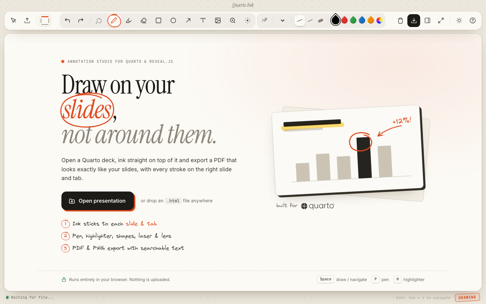

# Quarto Ink 🖋️
  


<p align="center">
  <strong>The Professional Annotation Orchestrator for Quarto & Reveal.js</strong><br>
  Elevate your data storytelling with precision drawing, state-aware persistence, and seamless slide integration.
</p>

<p align="center">
  <a href="https://quarto.ink/">
    
  </a>
  
  
</p>

---

## 🌟 Overview

**Quarto Ink** is the professional choice for interactive storytelling. Built specifically for **Quarto Reveal.js** presentations, it provides a powerful annotation engine that runs **entirely in your browser**.

### 🔒 100% Local & Private
Unlike cloud-based annotation tools, Quarto Ink processing happens entirely on your machine.
- **No Server Required**: Load your local `.html` files directly.
- **Data Privacy**: Your annotations and slides never leave your computer.
- **Offline Capable**: Perfect for presenting in environments without internet access.

### 🎯 The "Overlay" Philosophy
Quarto Ink acts as a non-destructive **transparent layer** over your presentation. It captures your ink, tracks your slide position, and even understands the internal state of your Quarto components (like tabs and fragments).

**Compatibility Note**: Designed exclusively for **Quarto Reveal.js** exports (`.html` files).

---

## 🛠️ Advanced Features

### 🧩 Tab-Aware Annotation (Exclusive)
Quarto Ink isn't just "over" your slides; it's **context-aware**. If your slide contains a [Quarto Tabset](https://quarto.org/docs/presentations/revealjs/#tabsets), Quarto Ink automatically detects which tab is active.
- Annotations are **scoped to individual tabs**.
- Switching tabs hides/reveals the correct drawings instantly.
- No more overlapping annotations when cycling through complex data views.

### ⚓ 4-Directional Adaptive Toolbar
The interface is designed to respect your content. The main control pill can be docked to any edge of the screen:
- **Top/Bottom**: Optimized for horizontal layouts.
- **Left/Right**: Ideal for widescreen presentations, keeping controls near your hand.
- **Smart Popovers**: Tool settings and color pickers intelligently reposition themselves to avoid clipping at the screen edges.

### 🖋️ Precision Drawing Engine
Built for the **Apple Pencil** and high-resolution styluses:
- **Perfect Freehand API**: Pressure-sensitive, buttery-smooth strokes that feel natural.
- **Dynamic Thickness Presets**: Dedicated settings for Pen and Highlighter tools (saved per-tool).
- **Lasso Selection & Grouping**: Move or delete complex sketches as single objects.

### 🗂️ Several Presentations, One Window
Open more than one Quarto deck at the same time and switch between them with tabs above the slide.
- Select several `.html` files in the file picker (or drop them together); each deck gets its own tab, and **+** opens another one.
- Every deck keeps its own ink: switching saves the current deck and returns the other one to the slide where you left it (shown on the inactive tab).
- Closing the last tab brings back the start page. Opening a deck that is already open simply switches to its tab.
- Switching back to a deck you already opened is instant: it stays loaded on the same slide and Quarto tab. Up to four decks stay loaded; others reload when you return to them.
- Your tabs survive a reload: open decks, ink and positions are kept in the browser's local database (IndexedDB) and come back the next time you open Quarto Ink. Closing a tab removes the deck from that list (its ink stays saved).
- Note: open decks are held in memory, so very large exports (100 MB+) use a lot of RAM while their tab is open.

### 🎨 Atelier Interface
A paper-and-ink interface that looks annotated itself, in a warm *Paper* (light) and a *Midnight Ink* (dark) theme:
- **Floating tool capsule** that docks to any edge; the active tool is marked with a hand-drawn circle, colours are ink drops.
- **Dock compass**: a tiny screen map in the toolbar; click an edge to move the toolbar there.
- **Slide ruler**: the status bar shows one tick per slide; click or drag along it to jump between slides (hover shows the slide title).
- **Index-card navigator** with annotation counts, and a rubber-stamp badge for *Drawing* / *Navigating* mode.
- Works offline: all fonts are bundled locally, nothing is fetched from a CDN.

---

## 🚀 Workflow & Usage

### 1. Preparation
Simply open `index.html` in any modern browser. You will be greeted by the **Drop Zone**. 
- Drag and drop your **Quarto Reveal.js (.html)** file.
- Or use the "Open Presentation" button to browse for `.html` / `.htm` files.

### 2. Annotation
Once loaded, your presentation runs in a sandboxed iframe: its scripts cannot reach Quarto Ink or your stored annotations.
- Use **Drawing Mode** (Canvas Overlay) to sketch.
- Use **Navigation Mode** to interact with links or advance fragments.
- **Pro Tip**: Use the `Space` bar to toggle between modes instantly.

### 3. Distribution
Capture your brilliance using the **Export** menu:
- **PDF with ink**: every slide in order, with your annotations. Fragments are shown in full, and a slide with Quarto tabs gets one page per tab. Under "Tabs in the PDF" you can instead keep only the tabs with ink, or only the tab each slide shows.
- **PDF without ink**: the same pages without annotations, e.g. as a clean handout.
- **Current slide as PNG**: the slide you are on, exactly as shown, with its ink.

Slides are rendered at twice their native size, independent of your window size, with the deck's own fonts and backgrounds. The text of every PDF page stays selectable and searchable. Everything happens in the browser; nothing is uploaded.

---

## ⌨️ Productivity Shortcuts

| Tool / Action | Shortcut | Mode Requirement |
| :--- | :--- | :--- |
| **Toggle Mode** | `Space` | None |
| **Pen / Highlighter** | `P` / `H` | Global |
| **Shapes (A / R / C)** | `A` (Arrow), `R` (Rect), `C` (Circle) | Global |
| **Selection (Lasso)** | `S` | Global |
| **Eraser** | `E` or `X` | Global |
| **Navigation** | `→` / `↓` / `N` | Navigation Mode (or Global fallback) |
| **Sidebar Toggle** | `L` | Global |
| **Undo / Redo** | `⌘ + Z` / `⌘ + Y` | Global |

---

## 🛠️ Development

The Excalidraw bundle (`excalidraw-widget/dist/`) is committed, because GitHub Pages serves the site without a build step.
After changing anything in `excalidraw-widget/`, rebuild and commit the result:

```bash
cd excalidraw-widget
npm ci
npm run check      # syntax-checks the build scripts
npm run build      # rebuilds dist/ and updates the cache-busting version in ../index.html
npx playwright install chromium   # once, for the browser tests
npm test           # browser tests: drawing, navigation, tabs, session restore, PDF/PNG export
QI_BROWSER=webkit npm test   # the same tests in WebKit (Safari, iPad); needs npx playwright install webkit
```

CI runs the same checks and tests, and fails if the committed `dist/` or `index.html` is out of date.

---

## 🛡️ Technical Architecture

- **Engine**: Vanilla JS (ES6+) host app, with the Excalidraw text/shape tools bundled from `excalidraw-widget/` (React + Vite).
- **UI layer**: `assets/ui/` holds the interface styles (`quarto-ink-ui.css`), the embedded display font (`fonts.css`) and small UI behaviours such as the slide ruler (`quarto-ink-ui.js`). `quarto-ink-export.js` runs the PDF/PNG export and writes the PDF itself; the slides are rendered inside the deck by `quarto-ink-export-agent.js` with [html-to-image](https://github.com/bubkoo/html-to-image) (MIT, built with small patches into `excalidraw-widget/dist/vendor/`).
- **Isolation**: decks run in iframes sandboxed without `allow-same-origin`. The host and the deck talk only through `postMessage` (a bridge script injected into the deck), and the deck gets in-memory stand-ins for storage and cookies.
- **State Management**: `Map`-based annotation storage with `slide::tab` indexing.
- **Performance**: Double-buffered canvas drawing with `requestAnimationFrame` for artifact-free rendering.
- **Persistence**: annotations, open decks and the tab session are stored locally in IndexedDB (older `localStorage` data is migrated automatically), so you can close the browser and resume anytime.

---

## 📝 License & Attribution

Licensed under the [MIT License](LICENSE). 
Created and maintained by [ofurkancoban](https://github.com/ofurkancoban).

---

<p align="center">
  <em>"Ink your data. Empower your story."</em>
</p>
